# Docket

A keyboard-only terminal outliner for one person with dozens of projects.
Every row is edited in place, metadata is typed as sigils, and a sidebar shows
which projects need attention.



## Install

On macOS or Linux, with Homebrew:

```bash
brew install --cask sglavoie/tap/docket
```

The cask installs `docket` and its short alias `dkt`. On macOS it also
installs [Docket.app](macos/README.md), which runs `docket` in its own window
with a global shortcut, quick capture, a Today widget and Spotlight results,
and two daily notices, Plan the day and Check in, that open Today when chosen.

From a clone, with Go 1.26 or newer and [`just`](https://github.com/casey/just):

```bash
just install   # puts docket in ~/.local/bin, linked as dkt
```

## Start

Run `docket`. An empty database opens a `Welcome` tutorial that teaches the
keys by having you use them; `:tutor` brings a fresh copy back, and `:help`
lists every key.

The outline lives in one SQLite file, by default
`~/.local/share/docket-v2/docket.db`; set `DOCKET_DB` to use another. Keep it
out of any folder a file sync tool copies: `:sync folder` shares the outline
between machines through such a folder instead, without putting the database
in it. The first launch of each day keeps a backup beside the database, and
the newest 14 are kept. A copy also goes to `Docket Backups` in iCloud Drive,
when there is one, every hour the outline has changed: `:backup` makes one
now, `:backup folder` sends them elsewhere and `:backup off` stops them.

## How it works

Six rules shape everything, and [`SPEC.md`](SPEC.md) holds them in full:

1. **Nothing asks a question.** Delete is instant; undo is the safety net.
2. **Rows never move by themselves.** Only you reorder.
3. **One way to do each thing.** No menu or palette repeats a key.
4. **Keys follow a grammar.** Motions, operators and acts on rows, with
   counts, as in Vim: `d3j`, `>}`, `5x`.
5. **Every keystroke paints within one frame**, even on 10,000 rows.
6. **Chrome is the sidebar, one header line and one status line.**

There is one kind of row. A row with a state is a task; one without is a note
or, ending in a colon, a heading. Top-level rows are projects. Metadata is
typed into the row as sigils:

| Sigil | Means |
| --- | --- |
| `$doing` `$waiting` `$done` … | State |
| `//` leading the line | A note; any other row under a project is a task |
| `!` | Flag |
| `@fri` `@dec4` `@+2w` | Deadline |
| `@@mon` | Not before |
| `*2w` `*monthly` | Repeats once closed |
| `#home` `#est=2h` | Tags, with an optional value |
| `%project` | On capture: where the row goes |

The same sigils filter the outline with `/`, as `/#home $next`, `/@week` or
`/$missed`, and `:save name` keeps a filter in the sidebar. `F` opens any
filter by name, among them the built-in `/now`: what you are doing, with the
steps still open under it.

## From a shell

```bash
docket add "Buy milk %home @fri"   # capture without opening the outline
docket ls '$next #home'            # print the rows a filter matches
docket ls                          # print the whole outline as text
docket --version
```

These are the only commands; everything else is done in the outline.

## Development

```bash
just check   # fmt, vet, test
just run     # against ./dev.db, never the real database
just lint    # golangci-lint and tidy module files
just stats   # the last 28 days from the log, read-only: done, picks, carried, added
just readme-media  # re-record docs/images/demo.svg from TestReadmeDemo; needs uv
just shots   # screenshot the everyday screens for a taste pass; needs vhs
just install-hooks # run just check and just lint before every push
```

See [`CLAUDE.md`](CLAUDE.md) for the layers and the rules for changes.

## License

[MIT](LICENSE)
