# tt — Terminal Tasks

`tt` is a local-first task manager for the terminal. Capture, plan, and finish
work in one keyboard-driven outline. Your tasks live in readable Markdown
files on your own disk.

The terminal is the core interface. [tt.app for macOS](macos/README.md)
wraps it with quick capture, menus, and notifications; the
[native iPhone app](ios/README.md) uses the same Go engine. Optional
[file exchange](docs/guide/storage.md#syncing-through-an-exchange-folder) keeps enrolled
working copies in sync through a folder you provide, including iCloud Drive.
There is no hosted server, account, or web interface.

There is no `tt add`: the command line is deliberately limited to diagnostics, conflict
recovery, device sync, workspace relocation, project export, and shell completion. Run `tt`
and the interface is the product.



Work is grouped into lanes and projects; Peek below the outline shows the selected
task's details. The animation is recorded from the real app over fictional tasks;
the key pressed is named in the title bar.

## What using it looks like

### Your first five minutes

Run `tt` after [installing it](#install-and-start). No project setup is needed:

1. Press `a`, type `Try Terminal Tasks`, and press `Enter`. Your task lands in
   Inbox under Unfiled.
2. Move to its row with the arrow keys, then press `w` followed by `t` to plan
   it for Today. Press `g` followed by `t` to open Today.
3. With the task selected, press `w` followed by `d` to complete it. It leaves
   Today; press `u` to undo and bring it back.
4. Press `/`, type `Terminal`, and press `Enter` to search. Press `Esc` to
   clear the search.

Press `?` whenever you want the keys for the surface you are on. Press `F10`
to browse menus; Task groups everyday actions under Plan, Status, and Details.

### Capture more in one line

Start with a title, then add one piece of metadata at a time. Create a project
with slug `web` using `P` then `a`. In the Outliner, press `a` and build up
this draft; each row below adds one instruction to the previous one:

| Draft | Result |
| --- | --- |
| `fix login redirect` | A task in the current project, or Inbox under Unfiled when browsing all projects |
| `fix login redirect %web` | The task goes to `web` |
| `fix login redirect %web @friday` | It is due next Friday; the preview shows the exact date |
| `fix login redirect %web @friday $today` | It is also planned for Today |

Press `Enter` when the draft is ready. Press `b` on the saved task to read its
details. Today is a plan; the task's status is still Backlog until you start
it with `wg`.

Later, add `!1` for high priority or `#auth` for a tag. See
[capture syntax and date rules](docs/guide/capture-reference.md) for the full reference,
including literal examples and batch capture.

## Mental model

**Status says where the work stands.** Each task has one of eight states:

```text
inbox  backlog  doing  waiting  paused  someday  done  canceled
```

**Today and Next are plans.** A task can belong to one at a time. Completing it
clears its plan. Use `wt` for Today, `wn` for Next, and `wb` for Backlog.

**Projects organize tasks.** Capture goes to the current project, or Unfiled
when you are browsing all projects. Tasks can have subtasks within their project.

**Modes choose what you see.** `Tab` cycles All → Today → Inbox → Next → Backlog
→ Due → Recent; `Shift+Tab` reverses it. All is home. Press `g` to see shortcuts
for jumping directly to a mode. [Modes and lanes](docs/guide/outliner-modes.md)
explains how each view groups your work.

## Install and start

```bash
go install github.com/sglavoie/tt@latest
tt
```

That needs Go 1.25.13 or newer and `$(go env GOPATH)/bin` — usually `~/go/bin` —
on your `PATH`. To build from a clone instead:

```bash
go build -o tt .
./tt
```

There are no prebuilt binaries and no package-manager recipes for the terminal
program; `go install` is its distribution path.

On macOS, [tt.app](macos/README.md) runs the same program in its own window and
adds a menu-bar shortcut, quick capture, and notifications. From a clone, run
`just mac-install` to build and install it; this requires the full Xcode app.

A new workspace starts locally in `~/.tt/`. Use `--data-dir`, `TT_DATA_DIR`, or
`tt workspace move` to select a different location. Moving into iCloud Drive or
another synced directory is an explicit choice; an existing selected iCloud
workspace is preserved.

Launch opens Active Projects in All mode, or your last active saved lens.
Press `Esc` to leave a restored lens. [Search and lenses](docs/guide/search-and-lenses.md)
explains saved views and how to reveal tasks hidden by filters.

## Platform support

`tt` is developed and used daily on macOS. The full test suite also runs on
Linux in CI on every push, so Linux is exercised but not daily-driven. Windows
is not supported.

## Your data

The Go engine makes no network calls and sends no telemetry. By default, the
terminal workspace lives under `~/.tt/`: a JSON catalog plus one readable
Markdown file per project. You can read, grep, edit, and back it up with ordinary
tools. An enrolled Mac or iPhone keeps its own local working copy and exchanges
changes through the chosen folder; when that folder is in iCloud Drive, Apple’s
file transport handles cloud delivery. See [Storage](docs/guide/storage.md) for
the working-copy layout and recovery instructions.

## Before you upgrade

Keep a backup of your workspace before upgrading. Migrations save a snapshot
first, but are one-way: older builds refuse a migrated workspace.

If something looks wrong, start with `tt doctor` for read-only diagnostics.
See [storage and recovery](docs/guide/storage.md) before using `tt doctor --fix`
or restoring a backup.

## Daily loop

The Outliner is the only primary task presentation:

1. `a` captures one or more tasks.
2. `gi` moves to Inbox for triage.
3. `w` opens the workflow chord over the ten destinations the `$destination`
   sigil names.
4. `wb`, `wn`, and `wt` organize work; `wg` starts it and `wd` completes it.
5. Direct metadata keys handle priority, dates, tags, and pin; state goes
   through the `w` chord above.
6. `/` searches for a task.
7. `Space` opens the occasional task tools, Delete among them, which asks
   before it removes anything.
8. `u` undoes the last change and `Ctrl+R` redoes it.

Together, these operations form one capture, triage, plan, execute, and
complete loop.

### Useful once you know the basics

Leave a [resume note](docs/guide/README.md#everyday-recipes) with `r` before
pausing a task; Peek (`b`) shows where to restart. During review, `R`
[acknowledges the task and advances](docs/guide/outliner-keys.md) to the next
visible task needing attention. If a view seems unexpectedly narrow, `Q`
[explains its active restrictions](docs/guide/search-and-lenses.md) and lets
you remove them individually. Inside compact capture, `Ctrl+N`
[saves and keeps capture open](docs/guide/capture.md) for another task or batch;
in the Outliner, that same key opens Notes.

## Keys at a glance

One key is one act, on every surface. `Space` is reserved for the destructive
and the rare.

| Keys | Act |
| --- | --- |
| `Tab` `g` `Enter` `Esc` | cycle modes · go to a mode · zoom in · unwind one rung |
| `a` `A` `e` `E` `Ctrl+E` | capture · child · inline edit · description · external editor |
| `w` | the workflow chord: `wi` `wb` `wn` `wt` `wg` `ww` `wp` `wm` `wd` `wc` |
| `!` `@` `#` `*` | priority · due, defer, and check-in · tags and context · pin |
| `-` `+` | step the deadline one day earlier · one day later |
| `[` `]` `>` `<` `%` `~` | outdent · indent · set parent · adopt children · move project · dependencies |
| `J`/`K` `Ctrl+J`/`Ctrl+K` | reorder one step · reorder to the far end |
| `/` `f` `F` `o` | search · row facets · which projects load · sort |
| `P` `Ctrl+P` `\` | project scope · pinned projects · named lenses |
| `v` `V` `Ctrl+A` | select one · select a range · select every visible row |
| `&` `;` `b` `O` | attachments · comments · Peek · outline-edit the project |
| `y`/`Y` `u`/`Ctrl+R` `Ctrl+N` `T` | copy · undo and redo · Notes · theme |
| `Space` `?` `q`/`Ctrl+C` | menu · the generated key reference for this surface · quit |

`?` is always the honest answer: it is generated from the same operation
descriptors that dispatch the keys, for whichever surface you are on.
[`docs/guide/outliner-keys.md`](docs/guide/outliner-keys.md) has the full table.

## Maintenance CLI

```text
tt [--no-advisories] [--notify] [--control PATH]
tt doctor [--fix] [--json]
tt conflict list [--json]
tt conflict show <id> [--json]
tt conflict resolve <id> --use local|remote|file [--file PATH]
tt sync enroll --exchange DIR --working-copy DIR [--snapshot-dir DIR] [--force]
tt sync join --exchange DIR --working-copy DIR
tt sync status [--json]
tt sync exchange [--folder DIR] [--json]
tt sync doctor [--json]
tt sync conflicts [ID] [--json]
tt sync resolve ID --version N|--current|--file PATH [--json]
tt sync diagnostics [--output FILE]
tt workspace [location]
tt workspace move <destination> [--force]
tt workspace backup <backup-directory>
tt workspace verify-backup <snapshot-directory>
tt completion bash|zsh|fish
tt project export <slug-or-id> [--file PATH|-]
tt project export --all [--dir DIR]
tt --version
```

Global flags are `--data-dir` and `--no-color`. Run `tt help <command>` for
per-command syntax.

For device sync, [enroll once or join an existing exchange](docs/guide/storage.md#syncing-through-an-exchange-folder).
Each device keeps a local working copy; the exchange folder carries changes
between them. Enrollment preserves the original workspace.

## Where to read more

Start with the [everyday recipes](docs/guide/README.md#everyday-recipes), or look
up a specific action in [`docs/guide/`](docs/guide/README.md):

- [`docs/guide/outliner.md`](docs/guide/outliner.md) — the index to the four
  Outliner files: the modes, the chrome around the list, the full key table and
  task actions, and row indicators, checklists, Peek, and multi-select.
- [`docs/guide/capture.md`](docs/guide/capture.md) — everyday capture and editing,
  with a linked [syntax reference](docs/guide/capture-reference.md).
- [`docs/guide/search-and-lenses.md`](docs/guide/search-and-lenses.md) — finding
  work and saving views, with a linked [search reference](docs/guide/search-reference.md).
- [`docs/guide/projects-and-notes.md`](docs/guide/projects-and-notes.md) —
  project scope, Select Project, project tags including `parked`, All Notes.
- [`docs/guide/storage.md`](docs/guide/storage.md) — working copies, file exchange,
  undo, backups, migration, and conflict recovery.
- [`docs/guide/retired-keys.md`](docs/guide/retired-keys.md) — every retired key,
  per surface, and what answers it now.

Mechanism — data boundaries, transaction mechanics, migration internals,
platform support — is [`docs/architecture.md`](docs/architecture.md).
Contributor invariants are [`CLAUDE.md`](CLAUDE.md), and the TUI scenario
harness is [`docs/tui-testing/README.md`](docs/tui-testing/README.md).

## Development

```bash
just test
./scripts/check_docs.sh
./scripts/run_tui_scenarios.sh
just search-bench
just ci
just readme-media
```

The scenario script replays the committed final-product TUI workflows plus the
snapshot-first migration and interrupted-activation recovery scenarios. It
re-selects tests `just test` and `just ci` already run, for a faster loop while
authoring one.

`just readme-media` re-records the animation above from `TestReadmeDemo`
(it needs [uv](https://docs.astral.sh/uv/)); CI fails when the committed copy
no longer matches what the app draws.

The [daily-use polish review](docs/tui-testing/daily-polish-review.md) records
presentation checks, search measurements, and allocation budgets. Run
`just search-bench --strict-time` on an idle machine to enforce latency targets too.

## License

MIT — see [`LICENSE`](LICENSE).
